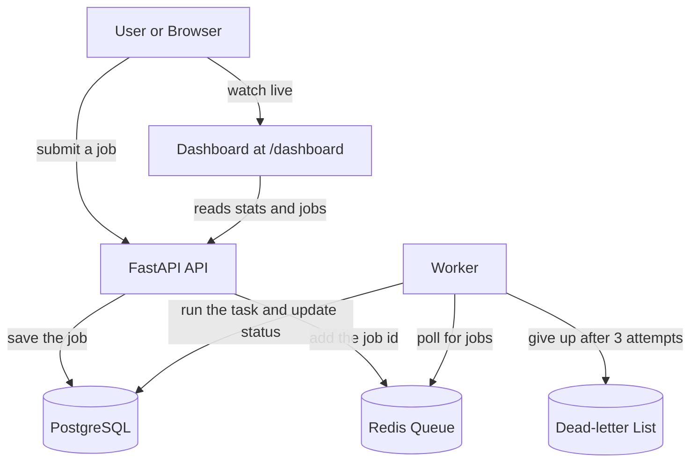

# TaskFlow

TaskFlow is a distributed job processing platform. You send it a job through an API, the job waits in a queue, and separate worker processes pick it up, run it, track its status, retry failures, and record the result. It is a smaller, understandable version of the systems large applications use to handle background work, such as Celery, Sidekiq, and BullMQ.

This repository was built from scratch, one step at a time, as a beginner friendly teaching guide for people who are new to coding.

## What it does

A job is any unit of work you want handled in the background, for example adding two numbers, converting text to uppercase, or waiting for a set time. You submit a job to the API, which saves it to the database and places it on a queue. A worker constantly watches the queue, takes each job, runs it, and records whether it succeeded or failed. A live dashboard shows everything as it happens.

## Architecture

The system is made of four parts that run as separate services and talk to each other over a private network:



The API accepts and reports on jobs. Redis holds the waiting line. The worker does the actual work. PostgreSQL stores every job and its result. Keeping them separate is what makes the system distributed: you could run many workers at once, or run each service on a different machine.

## Features

- Submit, list, and inspect jobs through a clean API
- A background worker that processes jobs from a Redis queue
- Automatic retries for failed jobs, with a limit of three attempts
- A dead-letter queue that holds jobs that permanently fail
- A per-job timeout that stops jobs which run too long
- Filtering jobs by status and a summary of counts per status
- A live web dashboard that refreshes on its own
- Automated tests and continuous integration on every push
- Fully containerized, runnable with a single command

## Technology

- Python and FastAPI for the API
- Redis for the job queue
- PostgreSQL for storage, accessed with SQLAlchemy
- A standalone Python worker
- Docker and docker compose to run everything together
- pytest for tests and GitHub Actions for continuous integration

## Running it with Docker

This is the easiest way and needs only Docker installed.

```
sudo service docker start
sudo docker compose up --build
```

Then open the dashboard at http://localhost:8000/dashboard and the interactive API docs at http://localhost:8000/docs. To stop everything, press Ctrl and C, then run:

```
sudo docker compose down
```

## Running it locally without Docker

You need Python and a running Redis server.

```
python3 -m venv venv
source venv/bin/activate
pip install -r requirements.txt
```

Start the API in one terminal:

```
uvicorn app.main:app --reload
```

Start the worker in another terminal:

```
python worker.py
```

## API endpoints

- GET /health, a simple check that the service is running
- POST /jobs, submit a new job
- GET /jobs, list all jobs, with an optional status filter such as /jobs?status=failed
- GET /jobs/{id}, fetch one job by its id
- GET /stats, a summary of how many jobs are in each status
- GET /dead, the records of jobs in the dead-letter queue
- GET /dashboard, the live web dashboard

## Running the tests

```
python -m pytest -v
```

## Deployment

Because the project is fully containerized, it can be deployed to any host that runs Docker, with free options including Render and Fly.io. You point the host at this repository, it builds the image from the Dockerfile, and you attach a managed PostgreSQL and Redis, setting the DATABASE_URL and REDIS_HOST environment variables to match. Running it locally with docker compose is the simplest way to see the whole system in action.

## Project structure

- app/main.py, the API and its endpoints
- app/database.py, the database connection
- app/models.py, the shape of a job in the database
- app/schemas.py, the shape of data going in and out of the API
- app/queue.py, the connection to Redis and the queue settings
- app/tasks.py, the work each job type performs
- worker.py, the background worker that runs jobs
- static/dashboard.html, the live dashboard page
- tests, the automated tests
- Dockerfile and docker-compose.yml, the container setup
